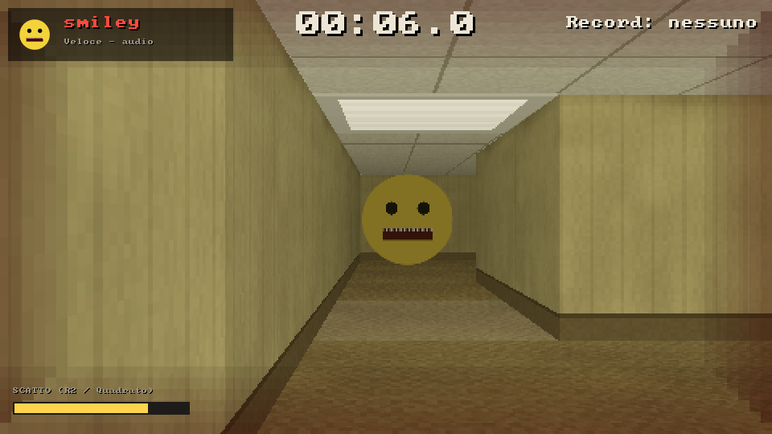
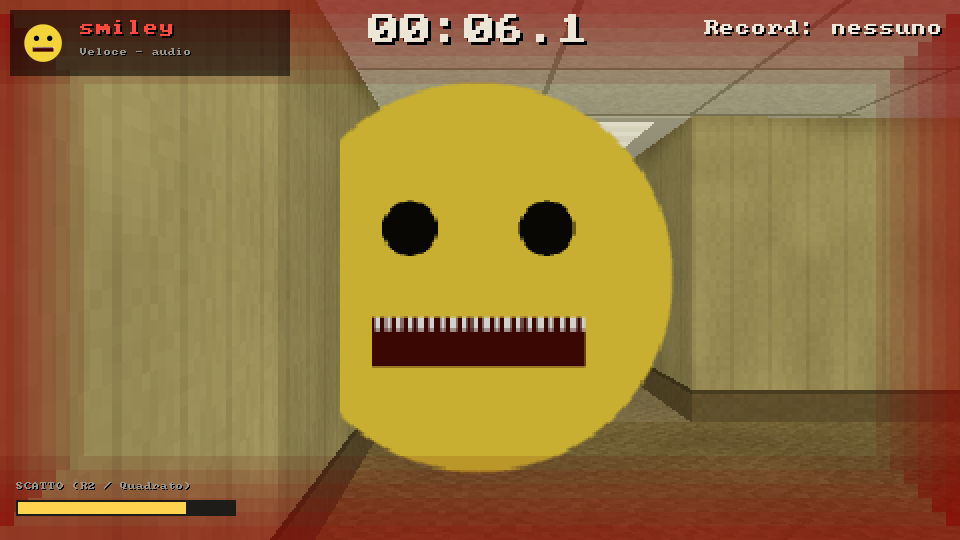
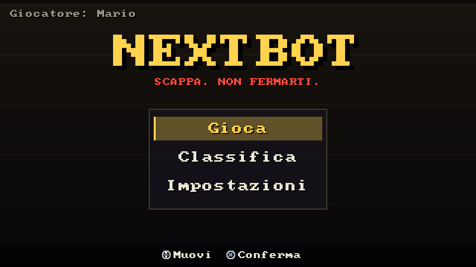
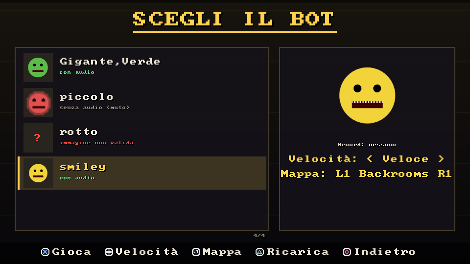
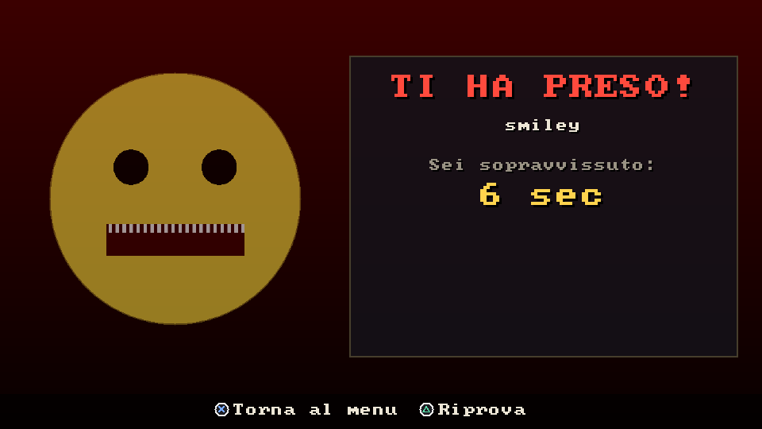
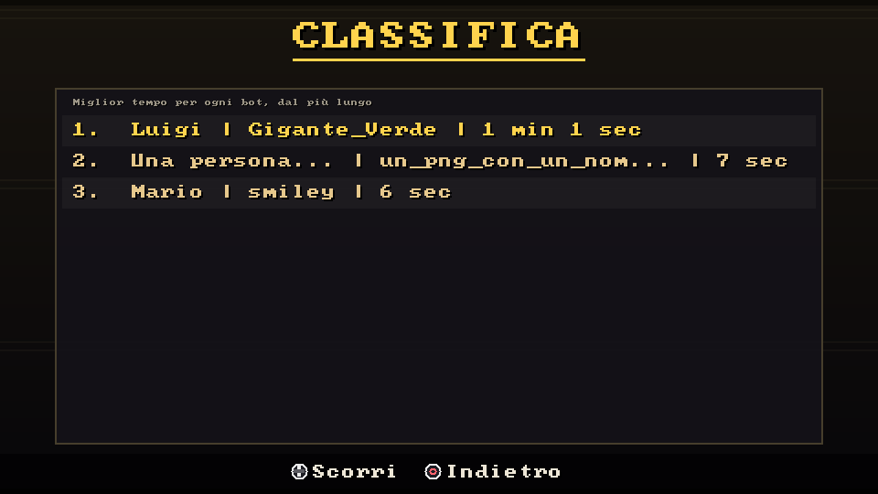

# Nextbot — gioco horror homebrew per PS4

Un'immagine PNG (il "nextbot") con il suo audio ti insegue dentro un labirinto: devi scappare più a lungo che puoi.
Si gioca **in prima persona** in corridoi stile *Backrooms*: carta da parati gialla, moquette umida, neon che
sfarfallano. Il bot lo vedi solo quando sbuca da un angolo, ma lo senti arrivare.

I bot li scegli tu: copi sulla console le tue immagini PNG e i tuoi suoni WAV, e il gioco li trova da solo.
Per ogni bot viene salvato il miglior tempo di sopravvivenza in una classifica.

| | |
|---|---|
|  |  |
|  |  |
|  |  |

*(Screenshot generati dal test harness su PC con un PNG di prova; sulla console l'immagine è identica, in 1920×1080.)*

> **Vuoi solo giocare?** Scarica il PKG già pronto dalle [Releases](https://github.com/Gab8bit/nextbot-ps4/releases)
> e segui [Installare e giocare sulla PS4](#7-installare-e-giocare-sulla-ps4). Non serve compilare nulla.

- **Piattaforma**: PS4 con exploit e GoldHEN (homebrew, PKG fake-signed). Non è un gioco ufficiale.
- **Title ID**: `NBOT00001` — **Content ID**: `IV0000-NBOT00001_00-NEXTBOTPS4000000` — **Versione**: `01.00`
- **Stato**: **testato su una PS4 reale con GoldHEN: funziona.** Passa anche 114 test automatici su PC.

---

## Indice

1. [Cosa è stato usato](#1-cosa-è-stato-usato)
2. [Come è fatto](#2-come-è-fatto)
3. [Cosa serve per lavorarci](#3-cosa-serve-per-lavorarci)
4. [Preparare l'ambiente (una volta sola)](#4-preparare-lambiente-una-volta-sola)
5. [Compilare e creare il PKG](#5-compilare-e-creare-il-pkg)
6. [Modificare il gioco](#6-modificare-il-gioco)
7. [Installare e giocare sulla PS4](#7-installare-e-giocare-sulla-ps4)
8. [Test, diagnostica e problemi noti](#8-test-diagnostica-e-problemi-noti)

---

## 1. Cosa è stato usato

| Cosa | Per cosa |
|---|---|
| **C++17** (dialetto `gnu++17`) | tutto il gioco |
| **[OpenOrbis PS4 Toolchain](https://github.com/OpenOrbis/OpenOrbis-PS4-Toolchain) v0.5.2** | header e librerie PS4, `create-fself` (crea `eboot.bin`), `create-gp4` e `PkgTool.Core` (creano il PKG) |
| **clang / lld 12** dentro **Docker** (Ubuntu 20.04, immagine `oo-ps4-build`) | compilatore e linker, uguali su Windows, Linux e macOS |
| **Librerie PS4** (tramite OpenOrbis): `libSceVideoOut`, `libSceAudioOut`, `libScePad`, `libSceUserService`, `libSceSystemService`, `libkernel` | video, audio, controller, nome utente, splash screen, file e thread |
| **[stb_image](https://github.com/nothings/stb)** (pubblico dominio) | decodifica dei PNG |
| **stb_image_write** | solo nei test su PC, per salvare gli screenshot e generare le icone |
| **GoldHEN** sulla console | per installare ed eseguire l'homebrew |

**Non** usa SDK Sony ufficiale, SDL, raylib, OpenGL o altre librerie: tutto il rendering è **software** (la CPU
scrive i pixel nel framebuffer), compresi il font bitmap e la vista in prima persona.

---

## 2. Come è fatto

### Struttura del repository

```
src/
  main.cpp              avvio: utente, pad, video, audio; loop a 60 fps con delta time
  platform/             tutto ciò che parla con la PS4
    video.cpp/.h          2 framebuffer 1920x1080 (double buffering), flip in vsync
    audio.cpp/.h          thread audio (sceAudioOut, 48 kHz stereo) + API del mixer
    mixer.cpp             mixer portabile: loop del bot con volume/pan, effetti sintetizzati
    wav.cpp/.h            parser WAV (RIFF) + conversione a 48 kHz stereo 16 bit
    input.cpp/.h          DualShock 4: tasti, levette, grilletti, lightbar, vibrazione
    fs.cpp/.h             cartelle, elenco file, lettura, scrittura sicura (tmp + rename)
    user.cpp/.h           nome dell'utente PS4 (sceUserService), fallback "Player"
    system.cpp/.h         orologio, sleep, splash screen
  game/                 logica del gioco (indipendente dalla PS4, testabile su PC)
    app.cpp/.h            macchina a stati: MENU -> GIOCO -> GAME OVER -> MENU, CLASSIFICA, IMPOSTAZIONI
    menu.cpp/.h           menu principale, scelta del bot, schermata classifica
    settings.cpp/.h       impostazioni (lista di voci) + conferma "Resetta classifica"
    game.cpp/.h           una partita: input, HUD, pausa, jumpscare e game over
    view3d.cpp/.h         raycaster in prima persona (pareti, pavimento, soffitto, nebbia, bot)
    map.cpp/.h            mappe a griglia (array statici '0'/'1') e collisioni
    pathfind.cpp/.h       A* a 8 direzioni + ricerca del punto più lontano
    player.cpp/.h         movimento, visuale, scatto con stamina
    bot.cpp/.h            inseguimento, accelerazione, volume/pan in base alla distanza
    leaderboard.cpp/.h    classifica (CSV), caricamento robusto, reset
    catalog.cpp/.h        scansione dei PNG/WAV e anteprime
    controls.cpp/.h       pressioni, ripetizione automatica, dead zone delle levette
    ui.cpp/.h             pannelli, titoli, icone dei tasti, finestre di messaggio
  gfx/
    draw.cpp/.h           primitive (rettangoli, trasparenze, triangoli, gradienti)
    sprite.cpp/.h         caricamento PNG, ridimensionamento (una volta sola), disegno con alpha
    font.cpp/.h           font bitmap 8x8 incluso nel codice (ASCII + vocali accentate)
third_party/            stb_image.h, stb_image_write.h
tools/                  test harness per PC (non finisce nel gioco)
  host_main.cpp           test automatici + partita simulata + screenshot + icone
  platform_host.cpp       sostituti PC delle funzioni PS4
sce_sys/                param.sfo (generato), icon0.png, pic1.png, about/right.sprx
sce_module/             libc.prx, libSceFios2.prx (dai sample di OpenOrbis, finiscono nel PKG)
docker/Dockerfile       ambiente di build Linux (clang/lld 12 + dipendenze di PkgTool)
Makefile                build PS4, PKG e test su PC (gira dentro il container)
build.cmd / build.ps1   build da Windows
build.sh                build da Linux/macOS
CLAUDE.md               specifica originale del progetto (vedi nota in fondo)
docs/screenshots/       immagini per questo README
```

### Come funziona, in breve

- **Livelli separati.** Solo `src/main.cpp` e i file in `src/platform/` (tranne `fs`, `wav`, `mixer`) usano API
  PS4. Tutto il resto è C++ normale: per questo lo stesso codice gira anche su PC nei test.
- **Loop.** `main.cpp` legge il pad, chiama `app_frame()` (aggiorna + disegna su un canvas 960×540) e
  `video_present()`, che lo scala 2× nel framebuffer 1920×1080 e aspetta il vsync: 60 fps con delta time.
- **Vista in prima persona** (`view3d.cpp`): raycaster su griglia in stile Wolfenstein (2.5D). Per ogni colonna
  dello schermo parte un raggio (DDA) fino al primo muro; pavimento e soffitto sono disegnati riga per riga. Le
  texture (carta da parati, moquette, pannelli, neon) sono generate dal codice all'avvio della partita. Una
  nebbia esponenziale scurisce le cose lontane. Il bot è uno sprite "cartonato" sempre rivolto verso di te;
  uno z-buffer per colonna lo nasconde dietro i muri. Rende a 480×270 (pixel grossi, look da VHS), poi scala 2×.
- **Bot** (`bot.cpp`): parte dal punto della mappa più lontano dal giocatore (BFS). Ricalcola il percorso con A*
  ogni 0,25 s, non a ogni frame. Se vede il giocatore in linea retta gli va dritto addosso, altrimenti taglia gli
  angoli puntando al nodo del percorso più lontano che riesce a vedere. Accelera piano col tempo (fino a +2,6
  caselle/s).
- **Audio** (`audio.cpp` + `mixer.cpp`): un thread separato manda blocchi da 256 campioni a `sceAudioOutOutput`.
  Il gioco gli comunica suono, volume e pan tramite variabili atomiche, senza lock. Il volume dipende dalla
  distanza (minimo 7%, così il bot si sente sempre). Il pan dipende da dove sta il bot rispetto a dove guardi. Gli
  effetti dei menu sono sintetizzati.
- **WAV** (`wav.cpp`): legge i chunk RIFF in qualunque ordine. Accetta PCM 8/16/24/32 bit e float 32, mono,
  stereo o multicanale, da 8 a 192 kHz, e converte tutto a 48 kHz stereo 16 bit al caricamento.
- **PNG** (`sprite.cpp`): decodificati con stb_image e ridimensionati **una sola volta** al caricamento: anteprima
  56 px e 170 px, texture del bot 256 px, jumpscare 470 px.
- **Classifica** (`leaderboard.cpp`): file `/data/nextbot/leaderboard.dat` in CSV:
  ```
  NEXTBOT_LB,1
  Mario,shrek,126000          <- utente, nome del PNG, millisecondi
  ```
  Un record per PNG (il migliore). Le righe rovinate vengono saltate; con file mancante o corrotto si parte da
  vuoto. Virgole e a capo nei nomi diventano `_`. Il salvataggio scrive `leaderboard.dat.tmp`, fa `fsync` e lo
  rinomina sopra l'originale, così uno spegnimento a metà non rovina nulla. È l'**unico dato salvato** dal gioco.
- **Asset esterni** (`catalog.cpp`): all'avvio crea `/data/nextbot/png` e `/data/nextbot/sounds` se mancano.
  Abbina `nome.png` a `nome.wav` (maiuscole e minuscole non contano); un bot senza WAV è muto.

---

## 3. Cosa serve per lavorarci

**Per compilare** (Windows è il sistema usato finora; Linux e macOS funzionano con `build.sh`):

| Requisito | Note |
|---|---|
| **Windows 10/11 x64** | oppure Linux/macOS (su Mac con Apple Silicon il container gira in emulazione amd64) |
| **[Docker Desktop](https://www.docker.com/products/docker-desktop/)** con container Linux (WSL2) | dentro gira il compilatore |
| **OpenOrbis PS4 Toolchain v0.5.2** con la cartella `bin/linux` | da scaricare a parte: non è nel repo |
| **Git** | per clonare |
| ~2 GB liberi | immagine Docker + toolchain |

Non serve installare clang, make o altro su Windows: è tutto nel container.

**Per provarlo sulla console**:

- una **PS4 con GoldHEN** (o un altro exploit che installa ed esegue PKG homebrew);
- un **client FTP** (FileZilla, WinSCP) o una chiavetta USB per copiare il PKG e gli asset;
- qualche **PNG** (meglio se con sfondo trasparente) e i **WAV** abbinati.

---

## 4. Preparare l'ambiente (una volta sola)

### 4.1 Struttura delle cartelle

Gli script si aspettano il toolchain **accanto** alla cartella del repo:

```
OpenOrbis\
  PS4Toolchain\          <- toolchain OpenOrbis (deve contenere bin\linux\create-fself)
  Nextbots\              <- questo repo
  oo-ps4-build.tar.gz    <- (opzionale) immagine Docker già pronta
```

Se il toolchain è altrove, imposta la variabile d'ambiente `OO_PS4_TOOLCHAIN` con il suo percorso.

### 4.2 Toolchain OpenOrbis

1. Scarica la release **v0.5.2** da <https://github.com/OpenOrbis/OpenOrbis-PS4-Toolchain/releases>.
2. Estraila in `OpenOrbis\PS4Toolchain`.
3. Controlla che esista `PS4Toolchain\bin\linux\create-fself` (insieme a `create-gp4` e `PkgTool.Core`):
   servono gli strumenti **Linux**, perché la build gira in un container Linux anche su Windows.

### 4.3 Docker

1. Installa Docker Desktop, attiva il backend WSL2 e avvialo (l'icona della balena deve risultare "running").
2. La prima build prepara da sola l'immagine `oo-ps4-build`:
   - se trova `..\oo-ps4-build.tar.gz` la carica (`docker load`);
   - altrimenti la costruisce da `docker\Dockerfile` (Ubuntu 20.04 + clang/lld 12 + librerie per PkgTool; serve
     internet, qualche minuto).

### 4.4 Clonare

```bat
cd C:\percorso\OpenOrbis
git clone https://github.com/Gab8bit/nextbot-ps4.git Nextbots
```

---

## 5. Compilare e creare il PKG

Da Windows, nella cartella del repo (da PowerShell anteponi `.\`, per esempio `.\build.cmd pkg`):

```bat
build.cmd              :: eboot.bin + sce_sys\param.sfo + pkg.gp4 + pkg-orbis-pub-gen.gp4
build.cmd pkg          :: tutto quanto sopra + il PKG installabile
build.cmd host-test    :: test automatici e screenshot su PC (vedi sezione 8)
build.cmd clean        :: cancella i file generati
```

Da Linux/macOS: `./build.sh`, `./build.sh pkg`, `./build.sh host-test`, `./build.sh clean`.

Risultato di `build.cmd pkg`: **`IV0000-NBOT00001_00-NEXTBOTPS4000000.pkg`** nella cartella del repo.

Cosa succede dietro le quinte (vedi il `Makefile`):

1. `clang++` compila ogni `.cpp` per `x86_64-pc-freebsd12-elf` con gli header OpenOrbis;
2. `ld.lld` collega tutto in `build/nextbot.elf`;
3. `create-fself` lo trasforma in `eboot.bin`;
4. `PkgTool.Core sfo_*` crea `sce_sys/param.sfo` (titolo, Title ID, versione…);
5. `create-gp4` scrive il progetto `pkg.gp4`, e `PkgTool.Core pkg_build` produce il `.pkg`.

In alternativa puoi creare il PKG con **orbis-pub-gen.exe** aprendo `pkg-orbis-pub-gen.gp4`. È lo stesso progetto
senza `sce_sys/about`, che orbis-pub-gen aggiunge da solo.

I file generati (`eboot.bin`, `*.pkg`, `*.gp4`, `param.sfo`, `build/`) **non** sono nel repo: si rigenerano con la build.

---

## 6. Modificare il gioco

### Il ciclo di lavoro

1. Modifica il codice in `src/`.
2. `build.cmd host-test`: compila il gioco per PC con AddressSanitizer/UBSan, esegue i test e simula una partita
   completa. Guarda gli screenshot in `build\host\*.png` e controlla che finisca con `== N passed, 0 failed`.
3. `build.cmd pkg`: crea il PKG.
4. Installalo sulla PS4 (sezione 7). Su console non c'è debug interattivo: più cose verifichi al passo 2, meglio è.

### Dove si cambia cosa

| Voglio… | File | Cosa toccare |
|---|---|---|
| cambiare nome, Title ID o versione del gioco | `Makefile` | `TITLE`, `TITLE_ID`, `CONTENT_ID`, `VERSION` (formato `XX.YY`). Se cambi il Title ID, cambia anche la parte corrispondente del `CONTENT_ID`. |
| aggiungere o modificare una mappa | `src/game/map.cpp` | scrivi un array di stringhe (`'1'` muro, `'0'` libero, tutte della stessa lunghezza, max 64×64) e aggiungi una riga a `MAPS[]` con nome, tema, dimensioni e punto di partenza. Il bordo diventa muro in automatico e le zone irraggiungibili vengono chiuse. I test controllano che la mappa sia valida. |
| velocità del bot / difficoltà | `src/game/bot.cpp` | `DIFF_SPEED[]` (caselle/s: lenta, media, veloce), `ACCEL` e `MAX_BONUS` (accelerazione nel tempo), `LOOKAHEAD` |
| ogni quanto ricalcola il percorso | `src/game/bot.h` | `BOT_REPATH_INTERVAL` (0,25 s); `BOT_CATCH_RADIUS` = distanza a cui ti prende |
| velocità del giocatore, scatto, rotazione | `src/game/player.h` / `player.cpp` | `PLAYER_WALK`, `PLAYER_SPRINT`, `PLAYER_TURN`; stamina in `player.cpp` |
| volume del bot in base alla distanza | `src/game/bot.cpp` | `bot_volume_for_distance()` (`MIN_VOL`, `RANGE`), `bot_pan_for_side()` |
| colori, texture, nebbia, neon | `src/game/view3d.cpp` | `build_backrooms()` / `build_concrete()`: colori delle texture, `s_theme` (colore e densità della nebbia, frequenza dei neon); `PLANE` = campo visivo |
| un nuovo tema grafico | `map.h` + `view3d.cpp` | aggiungi un valore a `MapTheme` e una funzione `build_...()` richiamata da `view3d_init()` |
| dimensione del bot a schermo, jumpscare | `src/game/game.cpp` | `BOT_HEIGHT`, `BOT_TEXTURE`, `BIG_SPRITE`, `GO_SCARE` (durata del jumpscare) |
| HUD, pausa, schermata di game over | `src/game/game.cpp` | `render_hud()`, `render_vignette()`, `game_render()`, `gameover_render()` |
| testi e menu | `src/game/menu.cpp`, `settings.cpp`, `game.cpp` | le stringhe sono in italiano direttamente nel codice (UTF-8; il font supporta à è é ì ò ù) |
| aggiungere un'impostazione | `src/game/settings.cpp` | aggiungi una riga a `ITEMS[]` con le funzioni `value` / `change` / `activate`; se serve un valore nuovo, aggiungilo ad `AppSettings` in `settings.h` |
| effetti sonori dei menu | `src/platform/mixer.cpp` | `audio_mixer_init()`: toni e rumore sintetizzati (`synth_tone`, `synth_noise`) |
| cartella degli asset sulla console | `src/platform/fs.cpp` | `s_root` (`/data/nextbot`) |
| formati audio accettati | `src/platform/wav.cpp` | `wav_parse()` |
| icona e immagine di sfondo nella home PS4 | `tools/host_main.cpp` | `make_icon()` / `make_pic1()`: `build.cmd host-test` **rigenera** `sce_sys/icon0.png` e `sce_sys/pic1.png`. Per usare immagini tue, sostituisci i file (PNG **RGB 24 bit**, senza alpha: 512×512 e 1920×1080) e togli le due chiamate in fondo a `main()` di `host_main.cpp`. |
| aggiungere un file `.cpp` | — | basta crearlo in `src/game/`, `src/gfx/` o `src/platform/`: il `Makefile` prende da solo tutti i `.cpp` di `game` e `gfx`. Un nuovo file in `platform/` va aggiunto a `COMMON_SRCS` (se è portabile) o a `PS4_SRCS` (se usa API PS4; in quel caso aggiungi un sostituto in `tools/platform_host.cpp`). |
| aggiungere un test | `tools/host_main.cpp` | usa la macro `CHECK(condizione, "messaggio")`; per gli screenshot `shot("nome.png")` |

### Regole da rispettare (imparate a spese nostre)

- **Solo API che esistono davvero in OpenOrbis**: prima di usare una funzione `sce...` controllane la firma in
  `PS4Toolchain/include/orbis/*.h`. Niente SDK Sony, SDL, raylib.
- **`-std=gnu++17`**, non `c++17`: con lo standard "puro" la libc di OpenOrbis nasconde `fileno`, `DT_DIR`,
  `strtok_r` e altre funzioni POSIX.
- **Niente `<atomic>`**: con la libc++ di OpenOrbis non compila. Usa i builtin `__atomic_load_n` / `__atomic_store_n`.
- Se una funzione C sembra mancare (es. `abs`), includi esplicitamente l'header (`<stdlib.h>`).
- Il **`Makefile` deve restare con fine riga LF** (`build.cmd` invece è CRLF): `.gitattributes` lo garantisce.
- `/app0` (dentro il PKG) è **in sola lettura**: tutto ciò che si scrive va in `/data/nextbot`.
- Il rendering è software su CPU: evita operazioni costose per pixel. Misura con un piccolo benchmark su PC e
  conta che la CPU della PS4 è circa 4-5 volte più lenta. Oggi un frame in prima persona costa circa 1,2 ms su PC.
- Le immagini si ridimensionano **una volta sola al caricamento**, mai a ogni frame.

---

## 7. Installare e giocare sulla PS4

### Installare

1. Prendi il `.pkg` dalle [Releases](https://github.com/Gab8bit/nextbot-ps4/releases) (o compilalo, sezione 5) e
   copialo su una chiavetta USB (FAT32/exFAT) o mandalo via FTP.
2. Sulla PS4 con GoldHEN installalo con *Debug Settings → Game → Package Installer* (o con il Package Installer
   di GoldHEN).
3. Avvia **Nextbot** dalla home.

### Aggiungere i bot (PNG + WAV)

Gli asset **non** stanno nel PKG: stanno in `/data/nextbot/`. Al primo avvio il gioco crea da solo le cartelle:

```
/data/nextbot/png/              immagini:  shrek.png, obunga.png, ...
/data/nextbot/sounds/           audio:     shrek.wav, obunga.wav, ...  (stesso nome del PNG)
/data/nextbot/leaderboard.dat   classifica (la crea il gioco)
```

- Il nome deve coincidere: `png/shrek.png` ↔ `sounds/shrek.wav` (maiuscole e minuscole non contano).
- PNG fino a 4096×4096; meglio con trasparenza.
- WAV non compresso (PCM 8/16/24/32 bit o float), mono o stereo, qualsiasi frequenza comune, fino a 128 MB
  (vengono usati al massimo 10 minuti). MP3 e OGG non sono supportati: convertili prima, per esempio con Audacity
  (*Esporta → WAV 16 bit*).
- **Via FTP**: GoldHEN ha un server FTP integrato sulla porta **2121**. Collegati con FileZilla o WinSCP all'IP
  della PS4 e copia i file in `/data/nextbot/png/` e `/data/nextbot/sounds/`.
- **Via USB**: la chiavetta su PS4 è `/mnt/usb0/`; copia i file con un file manager homebrew.
- A gioco aperto, nella schermata *Scegli il bot* premi **Triangolo** per ricaricare la lista.

### Comandi

| Comando | Azione |
|---|---|
| Levetta sinistra | camminare avanti/indietro e di lato |
| Levetta destra | girare la visuale |
| Croce direzionale | su/giù cammina, sinistra/destra gira (girano anche L1/R1) |
| R2 / Quadrato (tenuto) | scatto in avanti, consuma stamina |
| OPTIONS | pausa |
| Nei menu | su/giù per muoversi, **X** conferma, **Cerchio** indietro |
| Scelta del bot | sinistra/destra = velocità, L1/R1 = mappa, Triangolo = ricarica |

- Due mappe: **Backrooms** (stanze aperte con pilastri, gialla) e **Bunker** (corridoi di cemento, buia).
- Quando il bot è vicino il suono aumenta, i bordi dello schermo pulsano di rosso, la visuale trema, i neon
  sfarfallano, la lightbar diventa rossa e il controller vibra.
- **Impostazioni**: volume, difficoltà predefinita e sensibilità della visuale (valgono solo per la sessione), e
  *Resetta classifica* (chiede conferma; la scelta predefinita è *No*).

---

## 8. Test, diagnostica e problemi noti

### Test su PC

`build.cmd host-test` compila la parte portabile del gioco per Linux, dentro lo stesso container, con
AddressSanitizer e UndefinedBehaviorSanitizer, ed esegue `tools/host_main.cpp`. Il test:

- controlla formattazione dei tempi, classifica (file mancante, vuoto, corrotto, righe duplicate, reset), parser
  WAV (7 formati diversi + file rovinati), ridimensionamento PNG, mappe, A*, collisioni e volume per distanza;
- crea PNG e WAV di prova (anche con nomi strani e un PNG rotto) e **simula una partita completa** con input finti:
  menu → scelta del bot → gioco → pausa → game over → classifica → impostazioni → reset;
- verifica che il bot sia **invisibile dietro i muri** e visibile quando è davanti;
- salva gli screenshot in `build\host\*.png`, e rigenera `sce_sys\icon0.png` e `sce_sys\pic1.png`.

### Diagnostica sulla console

- Il gioco scrive righe `[nextbot] ...` su stdout: bot trovati, record, errori di caricamento di PNG e WAV,
  problemi con le cartelle. Si leggono dal log del kernel se la tua versione di GoldHEN espone il klog (per
  esempio `nc <ip-ps4> 3232`).
- A schermo: un PNG non valido appare in lista come *immagine non valida*; un WAV non valido fa partire il bot muto,
  con un avviso rosso nei primi secondi; se le cartelle non si possono creare, la schermata *Scegli il bot* lo dice.

### orbis-pub-chk

`orbis-pub-chk` è il controllo di Sony per i giochi da mettere in vendita. Su un homebrew OpenOrbis segnala
sempre alcuni errori che **non impediscono** l'installazione né l'avvio con GoldHEN:

- `eboot.bin`, `libc.prx`, `libSceFios2.prx`: *library version information missing* / *SDK version must not be
  00.000* (sono fake-signed, non compilati con l'SDK ufficiale);
- `right.sprx` non valido e `sce_discmap.plt` mancante (file che solo l'SDK ufficiale genera);
- `pronunciation.xml` mancante (serve solo al riconoscimento vocale);
- avvisi su trofei, `nptitle.dat` e test su PS5.

`icon0.png` e `pic1.png` sono già nel formato richiesto (RGB 24 bit).

---

## Note

- **`CLAUDE.md`** è la specifica originale da cui è partito il progetto. Diceva "niente 3D", ma la vista
  **in prima persona** è stata richiesta dopo: è un raycaster 2.5D su griglia, senza GPU né modelli 3D. Il resto
  della specifica è rispettato.
- `sce_module/*.prx` e `sce_sys/about/right.sprx` vengono dai sample del toolchain OpenOrbis e servono a creare un
  PKG funzionante. `third_party/stb_*.h` sono di pubblico dominio (o MIT, a scelta).
- Il gioco non contiene immagini o suoni di terzi: i bot li aggiunge chi gioca.
